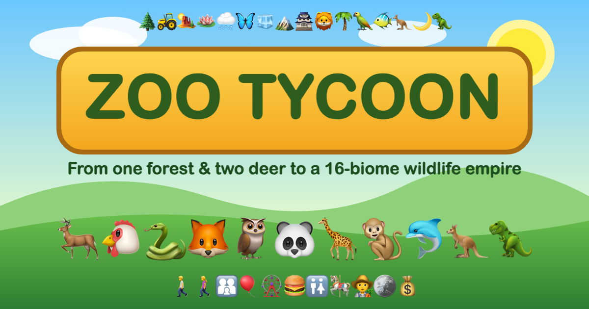

# 🦌 Zoo Tycoon



**Play it:** https://zoo-tycoon-hazel.vercel.app

Grow a tiny startup zoo — one forest and two deer — into a 16-area wildlife empire. A browser tycoon game in plain HTML, CSS and JavaScript (no build step).

## Features
- **Day-by-day simulation** with pause / 1× / 2× / 5× / 10× speed, seasons, weather and random events.
- **16 areas** to unlock, each with its own look, particles and starter animal: Forest (deer), Farm (chicken), Desert (rattlesnake), Wetlands (bullfrog), Taiga (red fox), Bug House (monarch butterfly), Arctic (snowy owl), Alpine (mountain goat), Bamboo Kingdom / China (panda), Savanna Safari / Africa (meerkat), Rainforest (monkey), Aviary (parakeet), Aquarium (goldfish), Outback (kangaroo), Nocturnal House (fruit bat), Jurassic Frontier (triceratops).
- **An animal shop in every area** with ~240 listings each (~3,900 in total): 30+ species × 8 variants (Spotted, Striped, Golden, Shadow, Albino, Giant, Rainbow…).
- **5 import companies** that differ in animal age, price, starting happiness and perks. Bulk discounts.
- **Breeding**: happy adult pairs have babies you can name yourself or let the game name. Rare mutations can show up.
- **Buildings you can upgrade**: enclosures, zookeepers, restrooms (Port-a-Potty → Luxury Spa Restroom), restaurants, gift shops, rest areas, themed attractions, rides and mascots. Park-wide entrance, parking and marketing upgrades.
- **Statistics**: visits, revenue, expenses and profit per area, plus charts over time.
- Autosaves to `localStorage`.

## Run locally
```bash
python3 -m http.server 5173
```
Then open http://localhost:5173.

Keyboard: `Space` pause · `N` next day · `1–4` speed.
